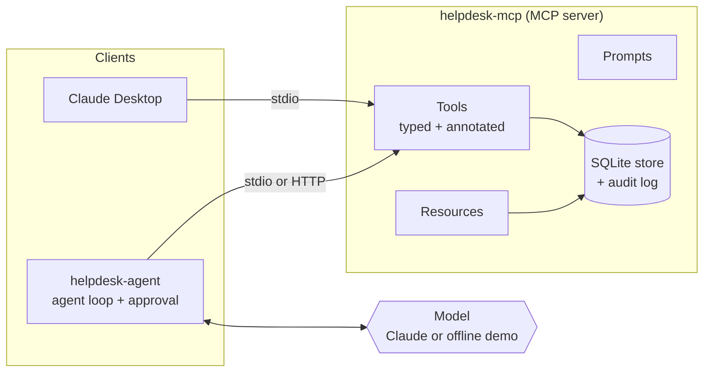

# helpdesk-mcp

A customer support helpdesk exposed over the **Model Context Protocol (MCP)**, plus an AI agent that triages tickets through it.

Plug the server into Claude Desktop (or any MCP client) and the model can search tickets, read customer history, look up knowledge base articles and leave notes. Or run the included agent, which connects to the server over MCP, discovers its tools at runtime, and asks a person before it changes anything.

It runs with no API key: an offline demo model drives the agent, so you can clone it and see it work in a minute.

[](https://github.com/s-talha/helpdesk-mcp/actions/workflows/ci.yml)

```text
$ helpdesk-agent --yes "Triage the urgent open tickets"
model: demo-offline   server: helpdesk-mcp over stdio

model  I'll find the urgent open tickets first.
call   search_tickets({"status": ["open"], "priority": ["urgent"], "limit": 3})
result {"result": [{"id": 2, "subject": "Charged twice for October", "priority": "urgent", ...
model  Reading 3 ticket(s).
call   get_ticket({"ticket_id": 2})
call   get_ticket({"ticket_id": 1})
call   get_ticket({"ticket_id": 3})
model  Checking the knowledge base for each one.
call   search_kb({"query": "Teachers locked out after SSO change"})
result {"result": [{"slug": "sso-setup", "title": "Setting up single sign-on (SSO)", ...
call   add_comment({"ticket_id": 3, "body": "Triage: urgent account ticket from an enterprise customer. Relevant article: sso-setup ...
model  Triage summary:
- #2 Charged twice for October (urgent, billing): article `refund-policy`.
- #1 Invoices export is empty since the update (urgent, bug): article `export-data`.
- #3 Teachers locked out after SSO change (urgent, account): article `sso-setup`.
I left an internal note on each ticket. Nothing was sent to customers.

5 model turns, 5,048 tokens, 0.1s
```

## What the server exposes

| Kind | Name | What it does |
| --- | --- | --- |
| Tool (read) | `search_tickets` | Text search plus filters for status, priority, category and unassigned. Most urgent first. |
| Tool (read) | `get_ticket` | Full ticket with customer and comments. |
| Tool (read) | `get_customer` | Company and plan. Email addresses are masked. |
| Tool (read) | `search_kb` | BM25 search over knowledge base articles. |
| Tool (read) | `ticket_stats` | Counts by status and priority, unassigned work, oldest open ticket. |
| Tool (write) | `add_comment` | Internal note by default, or a customer-facing reply. |
| Tool (write) | `update_ticket` | Status, priority and assignee, following the ticket workflow. |
| Tool (write) | `create_ticket` | Open a ticket for a customer. |
| Resource | `helpdesk://tickets/{id}` | A ticket as JSON. |
| Resource | `helpdesk://kb`, `helpdesk://kb/{slug}` | Knowledge base index and articles as Markdown. |
| Resource | `helpdesk://audit` | The latest writes, with who made them. |
| Prompt | `triage_ticket`, `draft_reply` | Reusable instructions for common jobs. |

## Safety by design

An MCP server hands real capabilities to a model, so the limits live in code, not in the prompt:

- **Typed, bounded inputs.** Every tool argument has a type and limits (ids at least 1, text length caps, enums for status and priority). The SDK rejects bad input before any of my code runs.
- **Business rules the model can't skip.** Status changes follow a fixed workflow, and closed tickets are final. A refused change comes back as a clear error the model can act on.
- **Read-only mode.** `--read-only` doesn't register the write tools at all, which is a good default for a first connection.
- **Tool annotations.** Each tool declares `readOnlyHint`, `destructiveHint` and `idempotentHint`, so clients can decide what needs confirmation.
- **Human approval in the agent.** The agent asks before running any tool the server marks as not read-only. A declined action is reported back to the model, which is told not to retry it.
- **Least personal data.** Customer emails are masked before they reach the model.
- **Audit log.** Every write is recorded with the actor, the action and what changed.
- **Errors that help, crashes that don't leak.** Expected failures raise `ToolError` with a useful message; anything unexpected reaches the model only as a generic error, and the details stay in the server log.

## Architecture



The agent never imports the server's code. It sees only what any MCP client sees, so it works the same against this server or any other.

## Getting started

Requires Python 3.11+ and [uv](https://docs.astral.sh/uv/).

```bash
git clone https://github.com/s-talha/helpdesk-mcp.git
cd helpdesk-mcp
uv sync --group dev

uv run helpdesk-agent "Triage the urgent open tickets"   # asks before each write
uv run helpdesk-agent --yes "Triage ticket 4"           # approve writes automatically
uv run helpdesk-agent --read-only "Triage ticket 4"     # server has no write tools
```

The demo database (10 customers, 16 tickets, 10 articles) is created at `~/.helpdesk-mcp/helpdesk.db` on first run. Pass `--db` to use another file.

To run the agent on Claude instead of the demo model:

```bash
uv sync --extra anthropic
export ANTHROPIC_API_KEY=...
uv run helpdesk-agent "Which unassigned tickets are at risk, and why?"
```

### Use it from Claude Desktop

Add this to `claude_desktop_config.json`, then restart Claude Desktop:

```json
{
  "mcpServers": {
    "helpdesk": {
      "command": "uv",
      "args": ["--directory", "/path/to/helpdesk-mcp", "run", "helpdesk-mcp", "--read-only"]
    }
  }
}
```

Remove `--read-only` once you're happy for Claude to add notes and update tickets.

### Run over HTTP

```bash
uv run helpdesk-mcp --http --port 8000          # Streamable HTTP at http://127.0.0.1:8000/mcp
docker build -t helpdesk-mcp . && docker run -p 8000:8000 helpdesk-mcp
```

## Tests

```bash
uv run pytest
```

40 tests cover the store (search ranking, workflow rules, masking, audit), the server through a real MCP client (schemas, annotations, read-only mode, invalid input, resources, prompts), and the agent (an end-to-end triage, declined approvals, read-only runs, step limits, and errors fed back to the model). Two tests start the server as a subprocess and talk to it over stdio, exactly as Claude Desktop does.

All tests use the offline demo model, so CI needs no secrets.

## Project layout

```
src/helpdesk_mcp/
  models.py        domain models and the status workflow
  store.py         SQLite store: queries, search, audit log
  seed.py          deterministic demo data
  server.py        the MCP server: tools, resources, prompts
  __main__.py      helpdesk-mcp command (stdio or HTTP)
  agent/
    loop.py        agent loop over an MCP client, with approval and step limits
    providers.py   Claude provider and the offline demo model
    cli.py         helpdesk-agent command
tests/
```

## License

MIT
